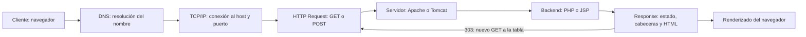

# Sistema de Registro de Contacto · Semana 09

Práctica grupal de Desarrollo de Aplicaciones Web (IS093A), UNCP, 29 de octubre de 2026. Dos aplicaciones equivalentes permiten registrar nombre y correo, validar en el servidor y consultar todos los contactos de la sesión. No necesitan frameworks, base de datos, login ni MySQL.

## Abrir las aplicaciones verificadas

- PHP: http://localhost/DAW_SEMANA9_GRUPAL/php-app/
- JSP: http://localhost:8080/contactos-grupal/
- Copia de entrega: `D:\xampp\htdocs\DAW_SEMANA9_GRUPAL`.
- Fuente de trabajo y evidencias: `D:\xampp\htdocs\DAW_SEMANA9_P2\DAW_SEMANA9_GRUPAL`.
- Proyecto anterior conservado: `D:\xampp\htdocs\DAW_SEMANA9`.

Apache y Tomcat deben estar iniciados. No usar Live Server ni abrir con `file://`: no ejecutan PHP/JSP.

## Funcionalidades y decisiones

El formulario envía por POST a **registro.php** o **registro.jsp**. Se eligieron estos nombres porque aparecen en la consigna técnica; las imágenes del código base usan `procesar.*`. Todos los enlaces y `action` son consistentes con los endpoints finales, sin mantener un procesador alternativo.

Un POST válido agrega un elemento a `registros` en la sesión y responde **303 See Other** hacia `registros.php` o `registros.jsp`. El GET siguiente muestra la tabla y un mensaje de éxito. Actualizar la tabla repite ese GET, por lo que no vuelve a insertar. Esta protección PRG no pretende impedir dos envíos manuales separados del mismo contacto.

Ambas versiones eliminan espacios exteriores, incluidos separadores Unicode; exigen nombre de 1 a 100 puntos de código sin caracteres de control y correo de hasta 254 caracteres ASCII con formato válido. Los límites HTML ayudan al usuario; la validación del servidor sigue siendo obligatoria. PHP usa `FILTER_VALIDATE_EMAIL`. JSP usa una expresión regular para direcciones habituales y un máximo de 64 caracteres antes de `@`. No verifican que el buzón exista; los validadores no son equivalentes para todas las direcciones excepcionales admitidas por los RFC.

Se conservan los datos normalizados y se escapan **al renderizar**, con `htmlspecialchars(ENT_QUOTES | ENT_SUBSTITUTE, 'UTF-8')` o una función Java que escapa `& < > " '`. Así, una etiqueta enviada como nombre aparece como texto. No se transforma HTML en código confiable ni se concatena entrada en atributos o scripts.

Los endpoints de registro responden **405 + Allow: POST** ante otros métodos y **400** ante datos inválidos; una validación fallida conserva los contactos anteriores. Los errores inesperados responden **500**, muestran un mensaje genérico y registran el detalle en los logs. PHP desactiva `display_errors` para estas páginas; no se cambió el `php.ini` global. JSP usa `error.jsp` y mapeos de error en `web.xml`.

PHP guarda varios contactos en `$_SESSION['registros']`; JSP guarda una `List<Map<String,String>>` en `session`. Se usa el objeto implícito JSP sin redeclararlo y se sincroniza el acceso a su lista. Se usan scriptlets sencillos, permitidos por la guía; **no se requiere JSTL ni ningún JAR adicional**. La tabla contempla la lista vacía y ofrece volver al formulario.

## Entorno realmente comprobado

| Componente | Versión | Ruta / evidencia |
|---|---|---|
| Apache XAMPP | 2.4.58 Win64 | `D:\xampp\apache\bin\httpd.exe -v` |
| PHP | 8.2.12 | `D:\xampp\php\php.exe -v`; ejecución HTTP mediante Apache |
| Java JDK / JVM activa | 26.0.1 | `C:\Program Files\Java\jdk-26.0.1\bin\java.exe` |
| Tomcat XAMPP activo | 8.5.96 | `D:\xampp\tomcat`; proceso Java con `catalina.base` y `catalina.home` en esa ruta; logs de despliegue |
| Puertos locales | Apache 80, Tomcat 8080 | Peticiones HTTP reales de las pruebas |
| Descriptor de esta aplicación | Servlet 3.1 (`javax`) | Compatible y probado con Tomcat 8.5; sustituye al descriptor Jakarta 5.0 anterior |

Se reutilizó la instalación existente. No se reinstaló software ni se cambiaron puertos, variables globales o configuración del servidor. Aunque el README anterior hablaba de otra instalación Tomcat 10.1, el proceso activo inspeccionado corresponde a **XAMPP/Tomcat 8.5.96**. Los logs incluyen un intento anterior de arranque duplicado con puerto ocupado; no fue necesario iniciar otra instancia para esta entrega.

## Estructura de entrega

```text
DAW_SEMANA9_GRUPAL/
├── php-app/
│   ├── index.html
│   ├── config.php
│   ├── registro.php
│   ├── registros.php
│   └── assets/styles.css
├── jsp-app/
│   ├── index.jsp
│   ├── registro.jsp
│   ├── registros.jsp
│   ├── error.jsp
│   ├── WEB-INF/web.xml
│   ├── WEB-INF/comun.jspf
│   └── assets/styles.css
├── pruebas/verificar_http.py
├── README.md
└── evidencias/
    ├── *.png
    ├── pruebas.json
    ├── respuestas-http.json
    ├── errores-500.json
    ├── logs-*.txt
    ├── estructura.txt
    └── visor-evidencias.html
```

## Instalación y despliegue

1. Mantener intacto `D:\xampp\htdocs\DAW_SEMANA9`. Extraer la carpeta de este ZIP como `D:\xampp\htdocs\DAW_SEMANA9_GRUPAL` para que coincida con la URL y con la ruta de la cookie PHP.
2. Iniciar Apache desde el panel XAMPP si está detenido. PHP se sirve directamente desde `htdocs`; no hay dependencias que instalar.
3. La instancia Tomcat de este equipo usa `D:\xampp\tomcat\webapps`. Confirmar que no exista otra aplicación `contactos-grupal` antes de copiar. Para una instalación nueva:

   ```powershell
   Copy-Item -LiteralPath D:\xampp\htdocs\DAW_SEMANA9_GRUPAL\jsp-app -Destination D:\xampp\tomcat\webapps\contactos-grupal -Recurse
   ```

4. Si Tomcat ya está activo, su `autoDeploy` detecta este contexto nuevo. Si está detenido, iniciarlo una sola vez desde XAMPP. No iniciar otra instancia si 8080 ya está ocupado. En este equipo se verificó el despliegue automático sin reiniciar ni sobrescribir `lab09` u otra práctica.
5. Abrir las dos URLs indicadas al comienzo. Registrar un contacto, volver al formulario y registrar otro: deben aparecer dos filas. Se puede abrir directamente `registros.*` para ver la lista o el mensaje vacío.

Para actualizar una instalación existente, conservar primero una copia de su código y reemplazar solo el contexto de esta práctica. Al cambiar de equipo, revisar rutas y puertos reales; si se cambia la ruta PHP, adaptar `path` de su cookie en `config.php`.

Las sesiones **PHP y JSP son independientes y no comparten contactos**. PHP usa la cookie `CONTACTOSGRUPALPHP` y archivos de sesión en `D:\xampp\tmp`, según la configuración existente; JSP usa `JSESSIONID` acotada al contexto y un tiempo de inactividad de 30 minutos. Una ventana privada sin esas cookies inicia otra sesión. No se empaquetan cookies ni archivos de sesión.

## Flujo HTTP



`localhost` puede resolverse mediante el sistema local o el archivo `hosts`, sin consultar un DNS externo. Para estas URLs HTTP, TCP conecta al puerto 80 o 8080; no se está usando TLS. HTTP transporta parámetros y cookies; la sesión se almacena en el servidor y la cookie permite asociar las peticiones sucesivas.

**Ciclo PHP:** Apache recibe la solicitud, el motor PHP ejecuta el archivo, carga la sesión antes de enviar contenido, valida los datos y actualiza la lista si procede. Devuelve una redirección o HTML; al terminar la petición se cierra y persiste la sesión. Un nuevo GET ejecuta `registros.php` y recorre los registros.

**Ciclo JSP:** Tomcat traduce la JSP a un servlet y lo compila al acceder por primera vez o tras cambios; inicializa la instancia y atiende peticiones mediante su método de servicio. Las solicitudes posteriores reutilizan el servlet compilado y la sesión correspondiente. Al retirar o recargar la aplicación se destruyen sus componentes. Las variables por petición están en scriptlets locales; no se guardan contactos en campos del servlet, que serían compartidos entre usuarios.

## Matriz PHP vs. JSP

| Aspecto | PHP en Apache/XAMPP | JSP en Tomcat |
|---|---|---|
| Ciclo de vida | Ejecuta el script por petición; el motor puede reutilizar bytecode mediante OPcache si está habilitado. | Traduce y compila a servlet, inicializa y atiende múltiples peticiones; recompila al detectar cambios. |
| Rendimiento | Depende del motor, cachés, código, I/O y concurrencia. | La primera compilación y el calentamiento JVM tienen coste; luego reutiliza clases y puede beneficiarse del JIT. |
| Despliegue | Archivos bajo htdocs con PHP habilitado en Apache. | Directorio de aplicación o WAR en webapps; descriptor compatible con el contenedor. |
| Estado | `session_start()` y `$_SESSION`; manejador de archivos existente. | `HttpSession` por cookie y atributos; cuidado con acceso concurrente a estructuras mutables. |
| Seguridad | Validar servidor, escapar HTML, proteger cookies, controlar errores y logs. | Las mismas medidas; EL sola no escapa HTML, usar `c:out` o escape explícito; no redeclarar objetos implícitos. |
| Madurez del ecosistema | Amplio ecosistema PHP, hosting extendido y herramientas como Composer, sin necesitarlo en esta práctica. | Ecosistema Java, herramientas Maven/Gradle y contenedores Servlet, sin necesitarlos para estas JSP. |

No se midieron latencias comparativas ni se afirma que una tecnología sea siempre más rápida. Una comparación cuantitativa requiere la misma carga, hardware, configuración y calentamiento.

## Cambios frente a los materiales originales

| Punto revisado | Práctica anterior | Código base de la guía (imágenes revisadas) | Entrega grupal |
|---|---|---|---|
| Datos | Nombre, correo y taller. | Nombre y correo. | Nombre y correo; se retira taller para cumplir el objetivo de contacto. |
| Estado | Reemplazaba `inscripcion` con el último envío. | Propone acumular `registros`, con partes pendientes. | Acumula contactos en sesión y muestra la tabla completa. |
| Validación | Ya tenía POST, límites, correo, 400/405 y escape. | Validación y escape incompletos; ejemplo PHP no fija 400 ante datos inválidos. | Conserva controles e incorpora espacios Unicode, lista vacía y 500 con logs. |
| Flujo | `procesar.*` → 302 → resumen. | `procesar.*` con salida directa. | `registro.*` → 303 → `registros.*`; cumple nombres de la consigna y PRG. |
| JSP | Descriptor Jakarta 5.0, una inscripción. | Redeclara `HttpSession session`, en conflicto con el objeto implícito. | Descriptor 3.1 probado, lista en `session`, escape Java sin dependencias JSTL. |
| Diseño | Tarjeta verde responsive. | Formulario y tabla básicos. | Reutiliza el CSS, añade tabla adaptable, mensajes y enlaces. |
| Entrega | Carpetas php/lab09 y jsp/lab09. | Solicita php-app y jsp-app. | Carpetas requeridas, documentación, pruebas y evidencias reales. |

Se conservaron el proyecto anterior y los cambios previos que ya había en el repositorio de trabajo. No se hicieron commits ni publicaciones.

## Roles: máximo dos integrantes

Reparto propuesto para completar el trabajo y la exposición; no acredita participación de una persona aún sin identificar.

| Rol técnico | Responsable | Responsabilidad |
|---|---|---|
| Arquitecto de despliegue | Jesús Antonio Ñahuinripa Zamudio | Rutas, versiones, XAMPP/Tomcat, puertos y logs. |
| Desarrollador PHP | Jesús Antonio Ñahuinripa Zamudio | POST, validación, sesión, tabla y escape HTML. |
| Desarrollador JSP | Segundo integrante pendiente | Revisar request, sesión, descriptor, escape y explicar el ciclo JSP. |
| QA y documentador | Segundo integrante pendiente | Revisar pruebas, evidencias, matriz y README. |

La implementación y las comprobaciones se realizaron con asistencia de Codex. Cada integrante debe revisar y comprender el código que va a exponer; no se inventan contribuciones del segundo integrante.

## Pruebas ejecutadas

Fecha: 29/10/2026, equipo local. Se usaron peticiones HTTP y Chromium automatizado sobre las URLs desplegadas. **38 comprobaciones funcionales y de seguridad pasaron**, más **2 pruebas controladas de HTTP 500**. La sintaxis de los tres archivos PHP pasó `php -l`. JSP se compiló y ejecutó realmente en Tomcat.

| Versión | Prueba | Resultado | Observación real |
|---|---|---|---|
| PHP | Lista vacía | PASS | 200 |
| PHP | Método GET | PASS | 405 Allow=POST |
| PHP | Método PUT | PASS | 405 Allow=POST |
| PHP | Método OPTIONS | PASS | 405 Allow=POST |
| PHP | Método HEAD | PASS | 405 Allow=POST |
| PHP | Vacíos | PASS | 400 |
| PHP | Espacios | PASS | 400 |
| PHP | Correo inválido | PASS | 400 |
| PHP | Nombre largo | PASS | 400 |
| PHP | Correo largo | PASS | 400 |
| PHP | Registro válido 1 | PASS | 303 registros.php |
| PHP | Registro válido 2 | PASS | 303 registros.php |
| PHP | Dos contactos y UTF-8 | PASS | 2 |
| PHP | Normalización | PASS | Se eliminan espacios exteriores |
| PHP | Actualizar sin duplicar | PASS | 2 registros después de GET |
| PHP | XSS escapado | PASS | Etiqueta presentada como texto, sin ejecución |
| PHP | Vista móvil | PASS | 390 px sin desbordamiento de página |
| PHP | Nueva sesión independiente | PASS | Sin cookies anteriores |
| PHP | Error conserva contactos | PASS | 3 contactos conservados |
| JSP | Lista vacía | PASS | 200 |
| JSP | Método GET | PASS | 405 Allow=POST |
| JSP | Método PUT | PASS | 405 Allow=POST |
| JSP | Método OPTIONS | PASS | 405 Allow=POST |
| JSP | Método HEAD | PASS | 405 Allow=POST |
| JSP | Vacíos | PASS | 400 |
| JSP | Espacios | PASS | 400 |
| JSP | Correo inválido | PASS | 400 |
| JSP | Nombre largo | PASS | 400 |
| JSP | Correo largo | PASS | 400 |
| JSP | Registro válido 1 | PASS | 303 registros.jsp |
| JSP | Registro válido 2 | PASS | 303 registros.jsp |
| JSP | Dos contactos y UTF-8 | PASS | 2 |
| JSP | Normalización | PASS | Se eliminan espacios exteriores |
| JSP | Actualizar sin duplicar | PASS | 2 registros después de GET |
| JSP | XSS escapado | PASS | Etiqueta presentada como texto, sin ejecución |
| JSP | Vista móvil | PASS | 390 px sin desbordamiento de página |
| JSP | Nueva sesión independiente | PASS | Sin cookies anteriores |
| JSP | Error conserva contactos | PASS | 3 contactos conservados |
| PHP | Error inesperado controlado | PASS | 500, mensaje genérico sin marcador interno y detalle en Apache/error.log. |
| JSP | Error inesperado controlado | PASS | 500, mensaje genérico sin marcador interno y detalle en localhost log. |

Durante la primera ejecución hubo un error de inferencia de tipos en `registros.jsp` con el compilador del Tomcat instalado. Se corrigió con `ArrayList<Map<String,String>>` explícito y se repitió la suite completa: todos los casos pasaron. Los logs previos pueden conservar ese error real; no se presentan como si nunca hubiese ocurrido.

Las pruebas 500 usaron páginas temporales que lanzaron excepciones identificadas como `QA_CONTROLADO_500_PHP/JSP`, reutilizando el manejador PHP y la página de errores JSP. Esas páginas se eliminaron y **no se incluyen en la entrega**. No se probaron todos los fallos posibles del servidor ni se forzó una caída de Apache/Tomcat. PRG se verificó actualizando la tabla, no como garantía ante reenvíos manuales o fallos de red.

Para repetir pruebas HTTP básicas, opcionalmente con Python 3 y su biblioteca estándar (no es requisito para ejecutar las aplicaciones):

```powershell
python pruebas/verificar_http.py
```

La suite usa sesiones nuevas en memoria, imprime cada resultado y falla si una comprobación no coincide. Se ejecutó también esta suite de biblioteca estándar: **32 comprobaciones HTTP correctas**, guardadas en `evidencias/repeticion-http.txt`. Los resultados guardados de Chromium/HTTP están en `evidencias/pruebas.json`; las cabeceras seleccionadas están en `respuestas-http.json`, sin cookies ni identificadores de sesión.

## Evidencias y capturas

- [x] Formularios: `PHP-formulario.png`, `JSP-formulario.png`.
- [x] Tablas con dos contactos: `PHP-tabla-dos-contactos.png`, `JSP-tabla-dos-contactos.png`.
- [x] Error del servidor ante correo inválido: `PHP-error-validacion.png`, `JSP-error-validacion.png`.
- [x] Entradas script mostradas como texto: `PHP-xss-escapado.png`, `JSP-xss-escapado.png`.
- [x] Vista móvil: `PHP-movil.png`, `JSP-movil.png`.
- [x] Respuestas HTTP: `respuestas-http.json`, `errores-500.json` y `respuestas-http.png`.
- [x] Extractos de logs reales: `logs-*.txt` y `logs.png`.
- [x] Estructura real: `estructura.txt` y `estructura.png`.

Las diez capturas de aplicaciones se tomaron en Chromium durante la prueba real. Las capturas de HTTP, logs y estructura muestran un **visor HTML de los datos recogidos**, no una consola simulada ni DevTools. El visor incluye la procedencia de cada dato y se puede abrir en `evidencias/visor-evidencias.html`. Los extractos se limitan a esta práctica; los logs de servidor completos permanecen en sus rutas originales:

- Apache: `D:\xampp\apache\logs\access.log` y `error.log`.
- PHP: la configuración declara `D:\xampp\php\logs\php_error_log`, pero ese destino no existe en este equipo; se verificó el marcador PHP real en `D:\xampp\apache\logs\error.log` mediante el fallback de Apache. No se modificó la configuración funcional.
- Tomcat: `D:\xampp\tomcat\logs\catalina.2026-10-29.log`, `localhost.2026-10-29.log` y `localhost_access_log.2026-10-29.txt`.

Si el docente requiere capturas de herramientas originales: abrir DevTools → Red, enviar un formulario con «Conservar registro» activo y capturar el POST 303/GET 200; abrir `registro.*` por URL y capturar 405/`Allow: POST`. Para 400, desactivar `required` y `type=email` en DevTools y enviar vacío o inválido. Abrir los logs indicados en el editor y capturar los marcadores QA, y abrir `D:\xampp\htdocs\DAW_SEMANA9_GRUPAL` en el Explorador para la estructura. No se ha inventado una captura de esas herramientas.

## Para la exposición y pendientes

Explicar: el navegador envía datos; el servidor valida y conserva el estado; la cookie identifica la sesión; PRG separa la inserción del GET de la tabla; escapar al mostrar evita ejecutar HTML del usuario. En PHP cada petición ejecuta el script; en JSP Tomcat reutiliza el servlet generado.

Pendiente únicamente identificar al segundo integrante y confirmar su reparto de revisión/exposición. Las capturas originales de DevTools/Explorador son opcionales según lo que solicite el docente. No hay verificaciones funcionales pendientes para los casos enumerados. El ZIP contiene código, README, prueba repetible y evidencias disponibles, sin `.git`, temporales, clases compiladas ni datos de sesión.
